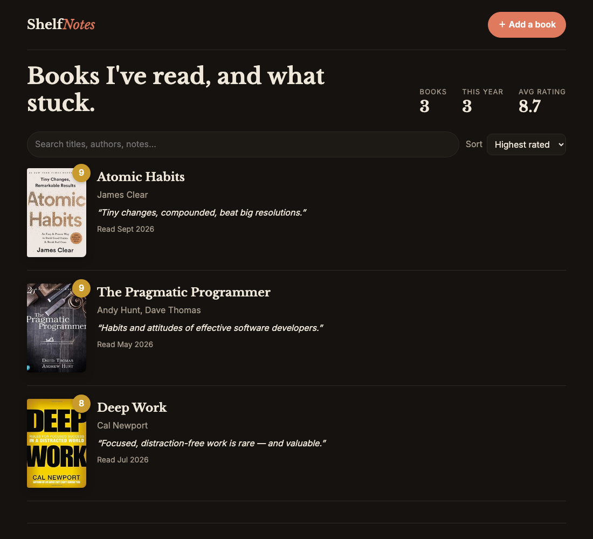

# 📚 ShelfNotes

> A personal reading log: rate the books you finish, write what stuck, and see your shelf with real covers. Search **Open Library** to add a book in two clicks. Built with Express, EJS, **PostgreSQL** and axios.

[](https://github.com/himanshuuem/shelfnotes/actions/workflows/test.yml)




## ✨ Features

- **Add from Open Library:** search by title, author or ISBN with the [Search API](https://openlibrary.org/dev/docs/api/search). Picking a result pre-fills the title, author, year and cover, and you can still add books manually.
- **Real covers** from the [Covers API](https://openlibrary.org/dev/docs/api/covers) at S, M and L sizes. Missing covers (Open Library's 1×1 placeholder) fall back to a styled book spine.
- **Full CRUD:** add, view, edit and delete, with a one-line takeaway, long-form notes (paragraphs preserved) and a 1–10 rating slider.
- **Sort and search:** recently read, highest rated or A–Z, and full-text search across titles, authors **and your notes**.
- **Shelf stats:** total books, books this year and average rating in one aggregate query.
- **Validation in both layers:** app-side field errors (422 re-render) and DB-side `CHECK` constraints (rating 1–10, year range), a `UNIQUE` Open Library key (duplicate gives 409) and a whitelisted `ol_key` format.
- **Offline tests:** the Open Library client takes an injectable HTTP client, so tests never hit the network.

## 🗄️ Schema

```sql
books (id SERIAL PK, ol_key UNIQUE, title, author, cover_id, year CHECK, rating CHECK 1–10,
       date_read DATE, summary VARCHAR(280), notes TEXT, created_at, updated_at)
-- indexes on date_read DESC and rating DESC for the two main sorts
```

## 🚀 Run Locally

```bash
git clone https://github.com/himanshuuem/shelfnotes.git
cd shelfnotes
npm install
cp .env.example .env     # set DATABASE_URL
npm run db:setup         # schema + 3 sample books
npm run dev              # http://localhost:3000
DATABASE_URL=postgres://... npm test
```

## ☁️ Deploy (free)

`render.yaml` provisions a free Postgres database and web service.

## 📚 Origin

This is my build of **Capstone 4: Book Notes** from the PostgreSQL section of [The Complete Web Development Bootcamp](https://www.udemy.com/course/the-complete-web-development-bootcamp/). The sample notes are example content. Book data and covers come from [Open Library](https://openlibrary.org).

---

Made by [Himanshu](https://github.com/himanshuuem)
